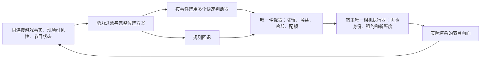

# 多判断器实时导播：协议、节奏和运镜

状态说明：本文保留最初共享设计及其离线边界。随后原生客户端已到 0.1.16，现役接通真实系统一，但先前只做保持/提案三题表决。2026-11-01 的概率与参数化运镜审计、当前热路径、测试及加载状态以 [导播逻辑审计](director-logic-audit-20261101.md) 为准。库内完整 CameraChoiceArbiter 的所有特性不能据此视为现役已经启用。

## 边界与基线

- 核心 main `b1adddfe` 的公开 `agent-mc-world/contracts` 已有 `DecisionPort`；宿主提供 `decisions.request`、模型选择和认证。可视化只按这个结构调用，不访问模型地址，也不把相机塞进 `mc_choose` 的路线/生存类别。
- 核心源码包为 `0.5.7-rc.150-preview.3`；本次查到 npm `latest=0.5.7-rc.47`、`next=0.5.7-rc.99`，两者不是同一个状态。Cortico 消费包标签为 `latest=0.1.2`、`next=0.4.1-rc.25`。本次不发布这些包。
- 可视化基于 main `aa6182d2` 合并到 `feat/director-ortho-20261101`。通用相机策略和轨迹维护在本仓库；宿主做事件汇聚、节目目的、数据归档、模型预算与唯一执行器接入。
- 人格、长期记忆、节目计划属于宿主。这个模块没有另一个人格、目标管理器或定时推理循环。导播只控制观战画面，不能操作被拍摄角色。

## 多个系统一怎样协作

不是让六个模型争抢控制权。先从当前后端能力生成最多七个完整方案，加上永久的 `keep`，然后让不同判断器对同一组选项投票。

完整方案同时绑定 `subjectUuid / sourceId / shotId / motion / axis`。模型只能选 ID，不能把一个人的机位和另一个人的动作拼起来，不能输出相机坐标、脚本、命令或自创能力。

| 判断器 | 要回答的问题 | 建议的宿主触发条件 |
| --- | --- | --- |
| story 事件焦点 | 哪个方案最能交代真实事件及其因果？ | 新事件、交流段落或场景目的改变 |
| action 动作可读性 | 能否看清威胁、工具、目标、协作和结果？ | 战斗阶段、关键交互或动作结果；连续打击先合并 |
| space 空间关系 | 矿道、楼层、遮挡和未加载区域是否表达清楚？ | 地点/房间/楼层变化；明确遮挡持续出现 |
| composition 构图 | 人物与动作目标可辨、留白与屏幕方向是否合理？ | 画面质量持续不足或出现新的关系对象 |
| motion 运镜机会 | 移动是否揭示新信息，是否有安全的起止机位？ | 到达、完成、发现、战后展示；关键战斗期间优先静稳 |
| continuity 连续性 | 现在切换的收益是否值得打断本段内容？ | 重要提案；通常可直接由规则否决 |

`createCameraJudgePanel` 默认只问 story、action、continuity。其他角色按需加入，同次可在一个 `DecisionPort.request` 中批量问六题，共用同一份事实。角色不同不意味着必须部署六个服务。若宿主需要按题路由不同模型，应在自己的 DecisionPort 适配器中完成并统一控制总并发。

建议几何感知 5–10Hz，机械跟随/插值随渲染帧运行；模型只在有意义的变化时调用。不要按每个移动包、每次掉血或每条弹幕发起一轮推理。慢速系统二可以由宿主每隔一段时间调整节目目的，不下发逐帧坐标，也不能越过仲裁器。

当前面板每实例最多一个在途请求，最少间隔 3 秒、最多 12 批/分钟、默认截止 800ms。超时不重试；服务不响应取消时仍占据在途槽位，避免下一批继续堆积。多个节目实例的全局预算仍由宿主管理。上述时间是默认门限，不是实测模型延迟。

## 输入、提示词、证据与回退

`buildCameraDecision` 接受有版本和采样时间的观察，输出 `mcvisual.director-choice/v1`：

- 连接/世界 `scope`、控制代次 `generation`、语义 `sceneKey`。
- `program` 是实际播出主体、机位、动作、原 operationId 和最新渲染证据；受理、切换中、未知、停止分开表示。
- 各主体的 UUID、真实加载/存活状态及来源；各方案的即时能力、碰撞后端、整段运动路径、楼层安全和轴线检查。
- 可见度、动作可读性、真实事件价值、构图和稳定性由宿主用实际感知计算到 0–1。不得用“预期会好看”冒充可见度或路径验证。
- 最多十二项按键替换的动态事实，每项发送不超过 220 字符，并带 `archiveRef`。同键后来的事实替换前者；原始全文不覆盖删除。

宿主必须保存原始观察、请求、返回、采用/拒绝原因和实际执行回执，并提供 `archiveRef` 对应的历史查询工具。面板提供 `onAudit` 回调保存原始请求/回答；它本身不是持久数据库或查询服务。实时模型只看裁剪后的当前事实，复盘时再查原文。

判断器 instructions 是固定文本，动态事实、候选和共享状态放在请求尾部。DecisionPort 的模型模板由宿主组织：固定系统前缀放前面，候选 criteria 与动态 state 放后面，不能把时钟和逐帧诊断插在前缀。语义 revision 排除采样时间；生产者也不能把每帧时间或坐标漂移写进 `sceneKey`/事实文本来伪造语义变化。

预算同时计算题目描述、criteria、state、宿主传入的 `prefixTokens`、`toolDescriptionTokens` 和 `reserveOutputTokens`。默认上下文预算 8192、预留输出 1024；宿主应注入实际 tokenizer，并为真实 Provider 配置相应输出上限。缺少 tokenizer 时用 UTF-8 字节数作保守输入度量，不声称这是所有模型的精确 token 数。

无模型、超时、错误、无效 ID、旧 revision/代次、重复角色投票均不获得控制权。规则继续评估，收益不足就保持当前镜头。服务报出的 confidence 不当作校准过的概率；模型投票的总加分默认最多 0.08，不能推翻硬条件，也不会为了六票一致就强制轮流展示人物。

## 切镜规则

普通节目采用以下初始值，可离线回放后再调：

| 条件 | 默认值与含义 |
| --- | --- |
| 同主体机位驻留 | 至少 10 秒；小幅连续避挡不算新镜头 |
| 主体驻留 | 普通场景基准 30 秒；根据已观察到的实际渲染开始计时，并按真实活动调整 |
| 持续改善 | 新方案综合分高至少 0.14，并连续胜出 1.2 秒 |
| 总切换配额 | 正常情况下每滚动分钟最多 4 次 |
| 换人配额 | 正常情况下每滚动分钟最多 2 次 |
| 返回上一主体 | 离开后至少 60 秒，避免 A→B→A |
| 创意运动冷却 | 环绕、推拉、升降等至少相隔 60 秒 |
| 临时遮挡 | 优先现有相机缩臂、稳定跟随、轮廓或已验证局部剖切；不因几帧被挡就换人 |
| 长遮挡 | 可信原生可见度低于 0.2 且已持续至少 2.5 秒，优先同主体稳定重构图 |
| 当前主体丢失 | 仅新鲜的原生加载/存活证据可以提出应急换镜；弹幕或模型判断不算证明 |

应急仍遵从手动锁镜、租约、原未知操作、正在过渡和执行器的最低驻留/恢复规则，不能通过换 ID 硬重投。应急候选必须实际可见，且不用创意运动；相邻应急切换至少隔 5 秒。

活动策略采用可选的 `subject.activity`，由核心事实在宿主侧映射：kind、since、lastProgressAt、采样 at、来源和 evidenceId。它是 v1 的兼容增量，缺少或不可信时保持原来的普通规则。

- 真正无动作、无交互、无进展持续至少 20 秒时降低该主体的节目价值，允许在完成 10 秒机位最低驻留后让位；新主体仍须持续胜出，配额和返回冷却继续生效。其他人也闲置时不会无意义轮播。
- 战斗有持续的真实进展时，主体保护期默认延长至 90 秒；副本的有效探索/交互进展默认 60 秒。新战斗在老镜头中途开始时，从战斗开始重新计算保护期。它们是允许重新评选的时间，不是到点强制切走。
- 新鲜证据确认的关键战斗阶段继续保持主体，并禁止创意绕镜抢走动作；正常的同主体稳定重构图仍可采用，原生丢失/遮挡应急也不被战斗标签阻止。
- 钓鱼、制作、容器界面、交流等可以站着不动，不能仅凭坐标相同就标记 idle。闲置标签若同时声称最近仍有进展，视为矛盾而忽略。
- 单纯“位于副本”不是进展。活动采样时间可刷新，但 lastProgressAt 必须对应真实行动、威胁、交互或阶段进展；超过默认 8 秒没有此类证据，战斗/副本标签不再延长保护。聊天断言不能制造活动证明。

节目在途、转场中或 unknown 时，仲裁器只返回 keep。模型投票不能把 accepted 变成 applied；实际相机完成也不表示宿主整轮决策或游戏目标完成。`recommendationId` 只是稳定提案 ID，宿主仍需用唯一事务执行器登记、去重、再验并查询原执行结果。

持续回放可以多次返回同一提案；不能因此每次创建一个新动作。已播 operationId 冲突、旧节目回放、控制代次/世界变化会停止旧仲裁器。当前原型最多记 256 个节目操作，达到后明确交还宿主归档，不静默丢弃去重证据；生产接入需使用宿主账本与受控会话轮换。

## 运镜脚本

### 正交相机与透视机位共用一个导播

正交是同一主体的投影选择，不是另一位游戏 Agent，也不能把隔离单机的窗口当作现役角色的画面。方案仍受 scope、UUID、代次、唯一执行器和原 actionId 约束。旧方案未标投影时保留原透视语义，“高位俯视”或名叫 isometric 的机位不自动成为正交。

完整候选新增可选的 projection、projectionProfile、transition。正交必须由当前后端明确声明 projectionReady，并绑定实际已配置的预设；没有安装或没有正确适配的后端不能靠模型选择变成可用。布局适合性由该主体的新鲜 viewContext 证明，不把聊天描述当作几何测量。

- 开阔基地、农田、建筑成果和多人关系可用正交全景/等距构图；保持主角可辨，缩放按构图而非固定距离。
- 窄矿道、未知场景不选正交。多层建筑只有当前楼层处理已验证时才能启用；不靠全世界统一的高度切面。
- 已在正交中进入已确认的窄矿道或失去楼层处理时，优先回到同一人物的可用透视机位，仍受手动锁镜、未知操作和原生执行门约束。
- 两种投影切换独立冷却默认 45 秒，避免不断透视/正交来回跳；普通同投影构图调整仍走原机位驻留。
- 同投影下可平滑调整角度和尺度。跨投影需要后端明确提供 cut 或 dissolve；不能把线性插值不同投影矩阵称作平滑跟随，也不能假设现役 450ms 叠化已自动覆盖未接入的正交端点。
- SDK/MCP 仍只选择注册过的 shotId，不接受模型自行塞入 yaw、scale 或 projection 参数。投影元数据由运行时注册表进入原操作；applied + rendered 还须匹配实际投影/预设回读。缺失或不符则保留原操作为 unknown，不换 ID 重投。

隔离正交源码已增加从 OrthoCamera 实际配置和渲染终态生成的投影/预设回读；不直接用请求文字冒充实际预设。候选 JAR 编译通过，但本次未替换实验实例或现役 JAR、未启动第二个客户端。现役 0.1.11 尚无正交插件/统一适配，不能宣称正式画面已切正交；后续先验收绑定与双向转场再加载。

`BoundedCameraMotion` 是可复用的有限轨迹内核，支持 hold、短弧 orbit_arc、push_in/pull_out、pedestal、truck、pan、tilt。动态人物跟随继续复用已存在的 Web/Java 相机求解器，不复制第二套跟随系统。

- 起点、关注点、终点、范围和时长明确，使用五次最小跃度曲线，起止速度与加速度归零；完成后保持终点，不持续绕圈。
- 默认 7 秒，范围 1–20 秒；默认移动上限 2.5 格/秒、转向 24°/秒。必要时延长时长，仍超界则拒绝，而不是突然加速。
- 环绕是相机围绕关注点移动，默认 45°、最多 90°。真实空间轨迹与只改 yaw 分开；保持世界上方向和实际主体高度。
- 推拉沿已确认视线移动，横移、升降、横摇、俯仰具有不同约束。镜头移动不伪装成变焦；暂不提供 FOV 动画来混淆这两种效果。
- 横摇在中段也保持俯仰；零长度视线、穿过关注点和地平线无定义的绝对垂直机位拒绝执行。
- 开始前检查整段路径；运行时重新检查实际曲线的扫掠区域、相机体积和关注点视线。未知地形不是空地。低帧率跳跃也不能直接跨过墙。
- 新障碍、楼层/世界变化、时间倒退或取消后停在最后确认安全的姿态，不能自动复活或穿墙回到起点。重新规划须由宿主提交新方案。
- 坐标使用 Y-up 的 position/focus/up；Java 适配使用 `toJavaCameraAngles`，向下看 pitch 为正。Web 用原生 lookAt；不直接把旧 Web 的负 pitch 拷到 Java。

轨迹内核本身通过离线数学/碰撞夹具，不等于所有后端已增加这些运动请求。现役 Java 0.1.11 仍只有五种视角；0.1.12 候选增加前视、斜前、侧拍、平视、仰视、有限环绕和推拉，已用真实隔离单机像素验证。未安装候选的客户端不能获得这些能力；多人构图、局部剖切仍未实现。详见[原生机位与验收边界](../tools/native-client-director/README.md)。

## 验证与部署分开

后续 0.1.12 候选补充原生 SDK 适配、单一机位规则、工具回执和取消，共 75 项共享检查通过；公开类型独立检查通过。218 项 Java 检查及成品 JAR 独立消费通过；隔离单机真实像素验证了前视、侧拍、仰视、60° 环绕、拉远和近墙第一人称恢复。现场仍是 0.1.11，未重启或替换。下述 62 项为前一阶段的历史结果。静态测试人物不是现役四位 Agent，也不是 LLM 选镜审美或直播平台最终节目验收。

命令 `npm run test:director` 检查相机事务、多个判断器、预算、取消、长回放和运动路径。公开导出类型用 `tools/orthographic-camera/test/public-api.mts` 独立检查；另用当前核心真实 DecisionPort 做双向类型兼容检查。

当前离线结果：62 项通过；十分钟意见反复回放零切换；持续活动十分钟回放 18 次换人，滚动分钟和返回冷却都满足；稳定好画面十分钟只调用一次模拟 Provider，没有为了轮流露脸切换。另覆盖真闲置让位、静止工作、晚开始的战斗、关键阶段、过期副本标签和自定义长驻留；新增正交能力/场景/转场门、独立冷却、同人透视回退、SDK与工具回执一致性及错误投影不可完成。还检查非合作服务超时不堆并发、停止后不复活、24/60fps 姿态一致、速度上限、视线符号及动态障碍。

这些不是实际模型的选镜审美、平均/尾延迟或 GPU 消耗验收。新多判断器与活动规则后续先做只读影子评估，不混入本次已授权的观战重启。原生 0.1.11 已回读到原账号、新会话认证、实际 attached 和 450ms 叠化完成状态；实际窗口确认跟随 DeepFish，随后自然切到 Coobot。直播平台最终节目画面与 YSM 全角色资源同步不由这些状态自动证明，仍单独记录。
